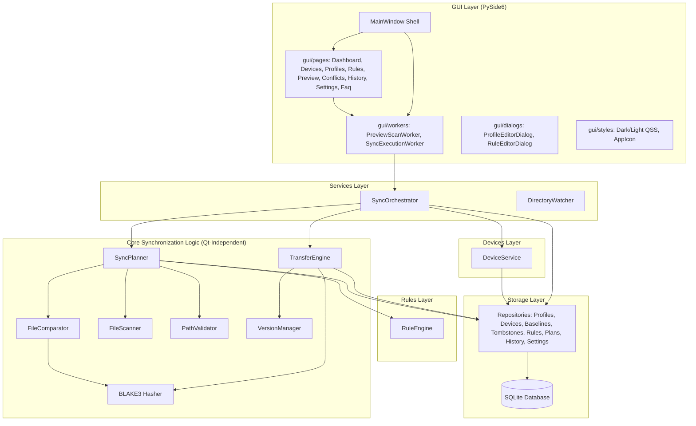

# SyncForge Architecture

## 1. Architectural Overview & Boundaries

SyncForge is a high-performance desktop file synchronization and backup application for Windows 11 built with Python 3.13, PySide6, SQLite, Watchdog, and BLAKE3.

The architecture strictly follows Separation of Concerns, Pragmatic SOLID principles, and Zero Data Loss guarantees:

---

## 2. Directory Structure and Module Responsibilities

### `syncforge.gui`
- `main_window.py` (~500 lines): Window shell, navigation routing, system tray lifecycle, session restore, and worker lifecycle coordination.
- `gui/pages/`:
  - `dashboard_page.py`: High-level metrics, connected drives, conflict counters, and quick actions.
  - `devices_page.py`: Hardware discovery, Volume GUID/serial inspection, and device enrollment with safety markers.
  - `profiles_page.py`: Profile listing, CRUD operations, JSON import/export, and preview triggers.
  - `rules_page.py`: Filter & routing rules table with inline combobox type editing, priority shifting, and enable/disable toggles.
  - `preview_page.py`: Dry-run planning table, interactive row action overrides, search/filtering, **Pause**, and **Stop** controls.
  - `conflicts_page.py`: Bidirectional conflict inspection and user decision resolution.
  - `history_page.py`: Audit history of completed/failed synchronization runs.
  - `settings_page.py`: User preferences (language, theme, buffers, autostart, tray).
  - `faq_page.py`: Interactive user guide, safety policies, and technical documentation.
- `gui/workers/sync_workers.py`:
  - `PreviewScanWorker`: Off-thread plan generation and progress reporting.
  - `SyncExecutionWorker`: Off-thread plan execution supporting interactive `pause()`, `resume()`, and `cancel()`.
- `gui/dialogs.py`:
  - `ProfileEditorDialog`: Profile creation/editing, folder mappings, device selection, and I/O throttling options.
  - `RuleEditorDialog`: Creation/editing of filter and routing rules.
- `gui/styles.py`: High-contrast Dark and Light QSS themes, application icon generator.

### `syncforge.core` (Pure Python, Qt-Independent)
- `planner.py`: Multi-profile and mapping planning for Safe One-Way (Mode A), Bidirectional (Mode B), and Cold Backup (Mode C). Generates 4-tier sorted operations (COPY, UPDATE, CONFLICT/deletions, SKIP).
- `comparator.py`: Metadata heuristic (FAST), SQLite baseline cache + sample check (BALANCED), and streaming BLAKE3 verification (FULL).
- `transfer_engine.py`: Atomic temporary file streaming, checksum verification, space checking, error handling, rate limiting, and instant pause/cancellation hooks inside chunk transfer loops.
- `scanner.py`: Efficient directory tree traversal with metadata extraction.
- `hasher.py`: Streaming BLAKE3 hash computation and head+tail sample hashing.
- `path_validator.py`: Junction, symlink cycle protection, and source/destination nesting rejection.
- `version_manager.py`: Timestamped archive and rollback management.
- `models.py`: Core dataclasses (`SyncProfile`, `PlannedOperation`, `PlanAction`, `ExecutionStatus`, etc.).

### `syncforge.services`
- `sync_orchestrator.py`: Orchestrates pre-write safety verification of target drives, planning, execution dispatching, audit history logging, and execution pause/resume/cancel forwarding.
- `file_watcher.py`: Debounced filesystem monitoring using Watchdog.

### `syncforge.devices`
- `device_service.py`: Windows drive enumeration, Volume GUID matching, Volume Serial verification, and persistent `.syncforge_id.json` marker tracking to eliminate wrong-drive write risks.

### `syncforge.rules`
- `rule_engine.py`: Precompiled regex-based filtering (EXCLUDE_GLOB, INCLUDE_GLOB, MAX_SIZE, MIN_SIZE) and target subfolder path routing (ROUTE).

### `syncforge.storage`
- `database.py`: SQLite connection pool, schema migrations, WAL mode, and busy timeout management.
- `repositories.py`: Data repositories for Profiles, Devices, Baselines, Tombstones, Plans, Rules, History, and Settings.

---

## 3. Pause & Stop Feature Architecture

A pause and stop capability was introduced to allow users to control heavy or long-running sync runs without risking file corruption:

1. **GUI Controls**: `PreviewPage` provides `⏸️ Пауза` (which flips to `▶️ Продовжити`) and `⏹️ Зупинити` buttons.
2. **Worker Control**: `SyncExecutionWorker` exposes `pause()`, `resume()`, and `cancel()`.
3. **Engine-Level Responsiveness**:
   - `TransferEngine` checks `_is_paused` and `_is_cancelled` both **between operations** and **inside each chunk copy loop** (`while self._is_paused: time.sleep(0.1)`).
   - Upon `cancel()`, any incomplete `.tmp` file is immediately deleted, preventing partial/corrupted files from remaining on the external drive.
4. **Audit History**: Interrupted jobs are recorded in SQLite history with `CANCELLED` status and accurate counts of successfully transferred files.

---

## 4. Guidelines for Adding Future Features

1. **Preserve Zero Data Loss**: Never delete or overwrite files without plan re-validation and explicit user permission.
2. **Keep Qt Responsive**: Perform hashing, scanning, disk writing, and heavy SQLite queries inside dedicated `QThread` workers.
3. **Decouple GUI & Core**: Business rules and file operations belong in `core/` and `services/`, never in GUI widgets or pages.
4. **Respect External Drive Hardware**: Keep I/O limits, buffer bounds, and sleep delays configurable. External drives must not be overloaded by unbounded parallel workers.
