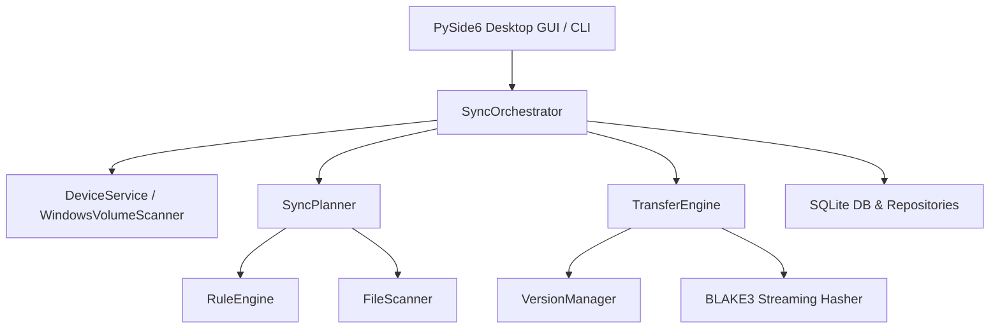

# SyncForge v1.0 — Developer & Architecture Documentation

## Architecture Overview

SyncForge is built using a clean layered architecture with complete separation between the sync engine, hardware discovery, and GUI presentation layer.

## Module Directory Structure

- `syncforge/core/`:
  - `models.py`: Data models (`SyncProfile`, `FolderMapping`, `PlannedOperation`, `DeviceInfo`, etc.).
  - `scanner.py`: Filesystem crawler with NTFS junction loop detection and directory boundary checks.
  - `hasher.py`: Streaming BLAKE3 file hashing with 1 MiB chunk buffers.
  - `planner.py`: Deterministic planner implementing Modes A, B, and C.
  - `transfer_engine.py`: Safe atomic file copying, temp staging, verification, and replacement.
  - `version_manager.py`: Snapshot archiving prior to update, pruning up to `max_versions`.
  - `path_validator.py`: Overlap detection, cycle detection, case-insensitive collision detection.
- `syncforge/devices/`:
  - `device_service.py`: Windows volume inspection (`GetVolumeInformationW`, `GetDiskFreeSpace`, `GetVolumeNameForVolumeMountPointW`) and multi-signal identity verification.
- `syncforge/rules/`:
  - `rule_engine.py`: Glob matching, file size limits, custom destination subfolder routing.
- `syncforge/storage/`:
  - `database.py`: SQLite connection with WAL mode and schema migration support.
  - `repositories.py`: Repositories for Devices, Profiles, Baselines, and Job History.
- `syncforge/scheduler/`:
  - `job_scheduler.py`: Background worker for periodic sync runs and automatic SSD plug-in triggers.
- `syncforge/gui/`:
  - `main_window.py`: PySide6 desktop GUI with dark theme, dashboard, devices, rules, preview, and conflicts tables.
- `syncforge/i18n/`:
  - `translations.py`: Ukrainian and English translations.
- `syncforge/cli/`:
  - `main.py`: Headless command-line utility for inspection and automated CI/diagnostics.

## Safety Invariants

1. **Non-destructive by default**: No automatic deletion propagation.
2. **Device Hardware Binding**: Writing is blocked if a candidate drive fails multi-signal identity check or exhibits cloned markers.
3. **Atomic Replacement**: All updates stream into `.tmp` destination files first, are hash-validated against source, and then replaced atomically via `os.replace`.
4. **Isolated Test Execution**: All tests run inside temporary synthetic directories (`tmp_path`) and never touch user personal directories.
